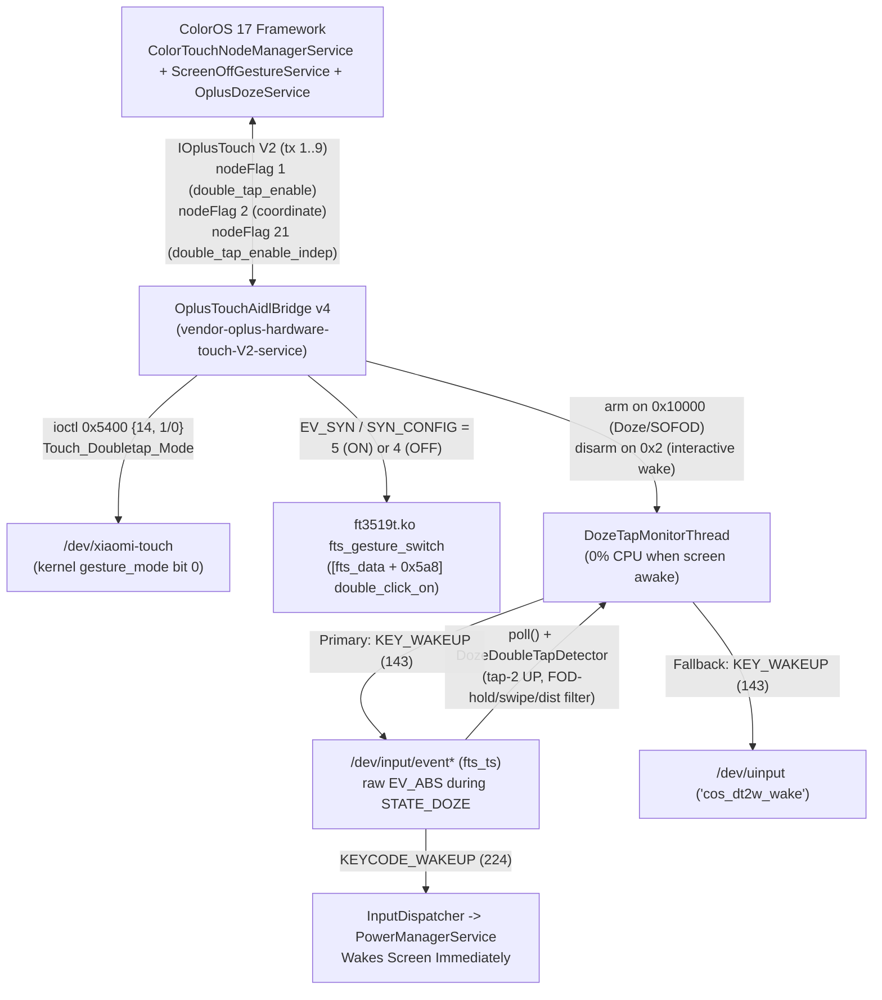

# ColorOS 17 Double-Tap-to-Wake (DT2W) AIDL V2 Bridge (`tanzanite`)

A standalone, zero-`libc++_shared.so` native C++ AIDL V2 Touch HAL bridge (`OplusTouchAidlBridge v4`) that connects **ColorOS 17 `vendor.oplus.hardware.touch.IOplusTouch/default` V2** (`ColorTouchNodeManagerService` / `ScreenOffGestureService` / `OplusDozeService`) to **Xiaomi's touch gesture kernel interface (`/dev/xiaomi-touch` + FocalTech `ft3519t.ko` `fts_gesture_switch`)**, plus a zero-idle-CPU **SOFOD / AOD in-Doze double-tap detector** that fixes quad-tap wake bugs when optical FOD or AOD is active.

> [!IMPORTANT]
> **Kernel Support Required for DT2W**:
> - **Your kernel MUST support hardware touch double-tap wake** — specifically:
>   1. Xiaomi's `/dev/xiaomi-touch` ioctl (`TOUCH_IOC_SET_CUR_VALUE = 0x5400`, `mode 14 = Touch_Doubletap_Mode`), **and/or**
>   2. Touch driver gesture suspend (`ft3519t.ko` `fts_gesture_switch` via `EV_SYN / SYN_CONFIG` values `5`/`4` and `fts_gesture_suspend()` keeping gesture scan active while the panel is OFF and reporting `KEY_POWER` / `KEY_WAKEUP`).
> - If a third-party/custom kernel strips, disables, or breaks touch gesture suspend (`fts_gesture_suspend` / `/dev/xiaomi-touch`), **pure screen-off hardware DT2W will NOT work** regardless of any userspace HAL bridge. Always verify your kernel has working DT2W before blaming the bridge.

> [!TIP]
> **Recommended Companion for DT2W on `tanzanite`**:
> Pair this bridge with [**`coloros-r2w-aidl-bridge`**](https://github.com/DwiPrdn/coloros-r2w-aidl-bridge) (`SensorsAidlBridge v3`), which provides ColorOS's virtual `oplus_prox_priority` (`type 33171066`) sensor without activating Xiaomi's ultrasound/touch `virtual_ps` (`fts_enter_proximity_mode(1)`). Without it, `ft3519t.ko` enters proximity suspend instead of gesture suspend and silently breaks DT2W while the screen is off.

---

## Test Environment & ROM Baseline

| Component | Details |
| :--- | :--- |
| **Test Device** | Redmi Note 14 4G (`tanzanite`, SKU `tanzanite_n_gl`) |
| **SoC / ABI** | MediaTek Helio G99-Ultra (`MT6789`), `arm64-v8a`, VNDK 31 |
| **Display / Touch IC** | 1080×2400 AMOLED (`panel_o7_38_0c_0a_dsc_vdo`), FocalTech `ft3519t.ko` (`fts_ts`, raw axis `17280×38400`, 16× logical scale) |
| **Kernel** | `5.10.251-HayaseYuuka-v3.4-MillenniumTeam+` (**SELinux Enforcing**) — also tested on `5.10.269-EvernightKernel-Android-PERMISSIVE` |
| **Stock Firmware (Base Vendor)** | HyperOS 2 — `OS2.0.214.0.VOGEUXM` (`Redmi/tanzanite/tanzanite:12/SP1A.210812.016/OS2.0.214.0.VOGEUXM:user/release-keys`, Android 12 / SDK 31 vendor) |
| **ColorOS Version** | ColorOS 17 (`V17.0.0`, Android 17 / SDK 37) |
| **ColorOS Base ROM** | OnePlus Ace 5 Ultra CN (`PLC110`), `PLC110_11_A.01` (`PLC110_11.A.01_001_202610210112`, `CP2A.260605.016 release-keys`) |
| **Deployment Method** | DSU (`vendor.img` repacked with `mkfs.erofs`) |

---

## What Is Bridged

| Layer | Target / Backend |
| :--- | :--- |
| **Exposed Service** | `vendor.oplus.hardware.touch.IOplusTouch/default` (Stable AIDL V2, hash `ef41c5fab372bb5ad6a417f606845c87cf0e9b17`, tx `1..9`) |
| **ColorOS Touch Node Protocol** | `nodeFlag = 1` (`/proc/touchpanel/double_tap_enable`) — master DT2W enable<br>`nodeFlag = 2` (`/proc/touchpanel/coordinate`) — gesture coordinate query<br>`nodeFlag = 21` (`/proc/touchpanel/double_tap_enable_indep`) — independent gesture + Doze/AOD bitmask (`0x02` = DT2W, `0x10000` = Doze/AOD, `0x10002` = both) |
| **Hardware Backend #1 (Xiaomi IOCTL)** | `/dev/xiaomi-touch` — `ioctl(fd, 0x5400, {14, 1/0, 0, 0})` (`TOUCH_IOC_SET_CUR_VALUE`, `TOUCH_MODE_DOUBLETAP = 14`) → updates kernel `gesture_mode` bit 0 |
| **Hardware Backend #2 (FocalTech Driver)** | `/dev/input/event*` (`fts_ts`) — writes `EV_SYN (0) / SYN_CONFIG (1)` with `value = 5` (ON) or `4` (OFF) into `ft3519t.ko` `fts_gesture_switch` → updates `[fts_data + 0x5a8]` (`double_click_on`) so `fts_ts_suspend()` keeps gesture registers `0xD0`/`0xCF` armed even when optical FOD (`fod_status >= 1`) is active |
| **SOFOD / AOD In-Doze Backend** | `DozeTapMonitorThread` (`DozeDoubleTapDetector`) — reads raw `EV_ABS` (`ABS_MT_SLOT`, `ABS_MT_TRACKING_ID`, `ABS_MT_POSITION_{X,Y}`) from `fts_ts` **only while in Doze/SOFOD** and injects `KEY_WAKEUP (143)` (`KEYCODE_WAKEUP 224`) via `fts_ts` (with `/dev/uinput` `"cos_dt2w_wake"` fallback) |
| **Complements Stock Vendor** | Stock Xiaomi `vendor.xiaomi.hardware.touchfeature@1.0-service` can remain untouched; ColorOS exclusively binds `vendor.oplus.hardware.touch.IOplusTouch/default` |

---

## Files Bridged / Modified

| File Path | Action | Mode / Owner | SELinux Context |
| :--- | :--- | :--- | :--- |
| `vendor/bin/hw/vendor-oplus-hardware-touch-V2-service` | **Added** | `0755` (`0:2000`) | `u:object_r:hal_oplus_touch_aidl_default_exec:s0` |
| `vendor/etc/init/vendor-oplus-hardware-touch-V2-service.rc` | **Added** | `0644` (`0:0`) | `u:object_r:vendor_configs_file:s0` |
| `vendor/etc/vintf/manifest/vendor.oplus.hardware.touch.xml` | **Added** | `0644` (`0:0`) | `u:object_r:vendor_configs_file:s0` |

### Required Kernel / Stock Vendor Interfaces
- `/dev/xiaomi-touch` (character device from Xiaomi touch driver)
- `/dev/input/event*` exposing `"fts_ts"` (or touchscreen `ABS_MT_POSITION_{X,Y}` device supporting `EV_SYN/SYN_CONFIG` and/or `KEY_WAKEUP`)
- `/dev/uinput` (optional fallback wake injector if `fts_ts` lacks `KEY_WAKEUP` or write permission)

---

## How the Logic Works

### Why Stock Xiaomi Touch HAL Breaks DT2W on ColorOS 17
1. **Different HAL & Node Model**: ColorOS 17 (`ColorTouchNodeManagerService`, `ScreenOffGestureService`, `OplusDozeService`) never calls Xiaomi's `ITouchFeature`. Instead, it binds `vendor.oplus.hardware.touch.IOplusTouch/default` (V2), probes `isTouchNodeSupport(0, nodeFlag)` (treating `ret > 0` as supported), and reads/writes virtual Oplus touch nodes `1`, `2`, and `21`.
2. **Decimal-Write / Hex-Read Bitmask Quirk (`nodeFlag = 21`)**: ColorOS writes `double_tap_enable_indep` as a **decimal** string (e.g., `"2"`, `"65536"`, `"65538"`), then reads it back with `Integer.parseInt(val, 16)` (hexadecimal!). Furthermore, when entering AOD/Doze, `OplusDozeService` writes `"65536"` (`0x10000`, Doze bit only) and later `"0"` when power-saving AOD fades out — naively treating `"65536"` or that `"0"` as "DT2W OFF" kills DT2W right after the screen turns off.
3. **FOD vs. DT2W Conflict in `ft3519t.ko`**: When optical FOD is enabled (`fod_status >= 1`), `ft3519t.ko`'s `fts_ts_suspend()` checks `[fts_data + 0x5a8]` (`double_click_on`, controlled by `fts_gesture_switch` via `EV_SYN / SYN_CONFIG 5/4`), not just `/dev/xiaomi-touch`'s `gesture_mode`. Driving only `/dev/xiaomi-touch` leaves DT2W unreliable whenever FOD is enrolled.
4. **SOFOD / AOD "Quad-Tap" Bug (`ro.vendor.mtk_aod_support=0`)**: During Screen-Off FOD (SOFOD) / AOD (`STATE_DOZE`), devices without native MTK hardware AOD map `STATE_DOZE` to HWC `POWER_MODE_ON`. That wakes `ft3519t.ko` out of hardware gesture suspend, so the touchscreen emits normal raw `EV_ABS` finger coordinates instead of hardware `KEY_POWER`. Android's `InputDispatcher` drops all raw touches in Doze (`"no touchable window"`), so taps 1 and 2 are ignored until the AOD times out or a 3rd/4th tap lands after full suspend.

### Bridge Architecture



### Detailed Implementation Breakdown
1. **ColorOS `IOplusTouch` V2 Transaction Surface (`onTransactTouch`, tx `1..9`)**:
   - Registers `vendor.oplus.hardware.touch.IOplusTouch/default` with `AIBinder_markVintfStability()`, version `2`, hash `ef41c5fab372bb5ad6a417f606845c87cf0e9b17`.
   - `isTouchNodeSupport(dId=0, nodeFlag)` returns `1` for `nodeFlag` `1`, `2`, and `21` (and `-2` for unsupported nodes or secondary panel `dId != 0`).
   - `touchReadNodeFile(0, 2)` returns valid ColorOS coordinate format (`1,540:1200,...`) for `OplusScreenOffGestureUtil.updateGestureInfo()`.
   - Handles both synchronous `touchWriteNodeFile` (tx `4`) and `oneway` `touchWriteNodeFileOneWay` (tx `6`).
2. **State-Accurate `nodeFlag = 21` (`double_tap_enable_indep`) State Machine (`handleWriteNode`)**:
   - Parses incoming decimal strings and stores canonical lowercase hex (`"2"`, `"10000"`, `"10002"`) so ColorOS's hex readback always round-trips cleanly.
   - Tracks `gNode1Enabled`, `gNode1ExplicitOff`, `gIndepDt2wEnabled`, and `gLastIndepMask`:
     - `mask & 0x3` (`"2"`): DT2W enabled; if bit 16 (`0x10000`) is clear, marks screen interactive (`gInDoze = false`); if `0x10002`, keeps `gInDoze = true`.
     - `mask & 0x10000` (`"65536"`): entering SOFOD/AOD Doze — **preserves** hardware DT2W and arms `gInDoze = true`.
     - `nodeFlag = 194` (`"0"` on cancelled wake): does **not** clear `gInDoze`.
     - `mask == 0` immediately after `0x10000` while `gNode1Enabled == true` (power-saving AOD fadeout): **preserves** hardware DT2W and keeps `gInDoze = true` until actual interactive wakeup writes `"2"`.
     - Explicit user disable (`nodeFlag = 1` `"0"` + `nodeFlag = 21` `"0"`): turns off hardware DT2W, sends `SYN_CONFIG = 4`, and disarms `DozeTapMonitorThread`.
3. **Dual Kernel Sync (`setXiaomiDoubleTapMode`)**:
   - Every enable/disable drives **both** `/dev/xiaomi-touch` (`ioctl 0x5400`, `{14, 1/0, 0, 0}`) **and** `sendFtsGestureSwitch(enable)` (`EV_SYN` / `SYN_CONFIG` `5`/`4` on `fts_ts`), keeping `gesture_mode` and `ft3519t.ko`'s `double_click_on` strictly synchronized even with FOD active.
4. **Zero-Idle-CPU In-Doze Double-Tap Detector (`DozeTapMonitorThread` + `DozeDoubleTapDetector`)**:
   - Sleeps completely on `std::condition_variable` whenever `!(gInDoze && gDt2wActive)` — **0% CPU and no open `fts_ts` fd while the screen is awake**.
   - When armed, opens `fts_ts`, normalizes raw coordinates via `EVIOCGABS` to logical `1080×2400`, drains stale pre-Doze events, and runs a strict filter that triggers **on tap-2 release (UP)**:
     - Single-finger only (multi-touch rejected)
     - Max tap hold duration: `<= 260 ms` (cleanly rejects optical FOD press-and-hold attempts!)
     - Max intra-tap drift: `<= 90 px` (rejects swipes)
     - Inter-tap gap: `10..380 ms` from tap-1 UP (`<= 500 ms` from tap-1 DOWN)
     - Max tap-pair distance: `<= 200 px`
     - Post-wake debounce: `500 ms` (plus instant reset/debounce if firmware hardware `KEY_POWER` fires first)
   - On match, injects a 12 ms `KEY_WAKEUP (143)` press/release pulse on `fts_ts` (falling back to virtual `/dev/uinput` device `"cos_dt2w_wake"` if needed).
5. **Runtime Debug Log Toggle (`bridge_log.h`)**:
   - Quiet by default (only 1-line boot banner and errors logged). Toggle live without rebooting:
     ```bash
     adb shell setprop persist.vendor.cos.bridge.debug 1   # enable verbose logs
     adb shell setprop persist.vendor.cos.bridge.debug 0   # silence verbose logs
     ```

---

## SELinux Enforcing Policy

See [`config/selinux_enforcing.cil.snippet`](config/selinux_enforcing.cil.snippet) for the complete audited Android 17 / VNDK 31 CIL rules (`hal_oplus_touch_aidl_default`, `hal_oplus_touch_aidl_default_exec`, `hal_oplus_touch_aidl_service`, `touchfeature_device`, `input_device_31_0`, `uhid_device_31_0`, and `vendor_service_contexts` mapping).

---

## Installation (Vendor Overlay)

1. Copy the files from `vendor/` (or the `v1.0.0` release archive) into your port's vendor tree:
   - `vendor/bin/hw/vendor-oplus-hardware-touch-V2-service`
   - `vendor/etc/init/vendor-oplus-hardware-touch-V2-service.rc`
   - `vendor/etc/vintf/manifest/vendor.oplus.hardware.touch.xml`
2. Append the entries from [`config/vendor_fs_config.snippet`](config/vendor_fs_config.snippet) and [`config/vendor_file_contexts.snippet`](config/vendor_file_contexts.snippet) to your `vendor_fs_config` and `vendor_file_contexts`.
3. If running **SELinux Enforcing**, merge [`config/selinux_enforcing.cil.snippet`](config/selinux_enforcing.cil.snippet) into your vendor SELinux policy (and recompile `precompiled_sepolicy` with `secilc`).
4. Repack `vendor.img` (e.g., `mkfs.erofs`).

---

## Building from Source

Requires **Android NDK r27c** (`aarch64-linux-android31-clang++`) and a ColorOS 17 / Android 17 `libbinder_ndk.so`:

```bash
export NDK_DIR=/path/to/android-ndk-r27c
export BINDER_NDK=/path/to/stock_cos/system/system/lib64/libbinder_ndk.so
./build.sh
```

Zero `libc++_shared.so` dependency (`-static-libstdc++`).

---

## Verification & Self-Test

```bash
adb push vendor/bin/hw/vendor-oplus-hardware-touch-V2-service /data/local/tmp/touch_test
adb shell 'chmod 755 /data/local/tmp/touch_test && /data/local/tmp/touch_test --self-test'
# Expected: exit code 0, ver=2, sup(0,1)=1, sup(0,21)=1, indep Doze state machine + 9 DozeDoubleTapDetector cases all PASS

adb shell service check vendor.oplus.hardware.touch.IOplusTouch/default
adb shell setprop persist.vendor.cos.bridge.debug 1
adb logcat -s OplusTouchAidlBridge
```

---

## Troubleshooting Guide

First, enable live verbose logging:
```bash
adb shell setprop persist.vendor.cos.bridge.debug 1
adb logcat -s OplusTouchAidlBridge InputReader ScreenOffGestureService
```

| Symptom | Likely Cause | How to Check & Fix |
| :--- | :--- | :--- |
| **Pure screen-off DT2W does not wake the phone at all** | **1) Kernel does not support DT2W**, OR **2) Xiaomi `virtual_ps` blocked `fts_gesture_suspend()`**, OR **3) `/dev/xiaomi-touch` permission/SELinux denial** | 1. Check `adb shell ls -lZ /dev/xiaomi-touch` and `adb shell dmesg \| grep -iE 'fts\|xiaomi-touch\|gesture'`. If the kernel never enters `fts_gesture_suspend` or reports `enter proximity suspend`, either your kernel doesn't support DT2W or `virtual_ps` is active.<br>2. Install [**`coloros-r2w-aidl-bridge`**](https://github.com/DwiPrdn/coloros-r2w-aidl-bridge) so `oplus_prox_priority` doesn't activate `virtual_ps`.<br>3. Check `OplusTouchAidlBridge` logs for `Touch_Doubletap_Mode -> 1 OK` and `fts_gesture_switch(..., SYN_CONFIG=5) OK`. |
| **DT2W works on pure black screen, but requires 3–4 taps (quad-tap) during SOFOD / AOD** | `DozeTapMonitorThread` failed to open `fts_ts` or inject `KEY_WAKEUP` (SELinux `input_device_31_0` / `uhid_device_31_0` denial, or `group input` missing) | With `debug=1`, lock the phone while AOD/SOFOD is showing and verify logs show:<br>`double_tap_enable_indep AOD/Doze mask=0x10000 ... (doze=1)`<br>`DozeTapMonitor: active on /dev/input/eventX`<br>`DozeTapMonitor: SOFOD/AOD double-tap detected! Waking screen...`<br>Check `adb logcat -d \| grep avc:.*hal_oplus_touch_aidl_default`. |
| **DT2W works only when FOD is disabled, breaks after enrolling a fingerprint** | `fts_gesture_switch` (`EV_SYN/SYN_CONFIG = 5`) failed to write to `fts_ts`, so `ft3519t.ko` `[fts_data + 0x5a8]` (`double_click_on`) stayed `0` | Verify `OplusTouchAidlBridge` logs `fts_gesture_switch(/dev/input/eventX, SYN_CONFIG=5) OK`. If `EACCES`, ensure `.rc` has `group system input` and SELinux allows `input_device_31_0` write. |
| **Double-tap toggle in ColorOS Settings doesn't stick or does nothing** | `IOplusTouch/default` not found or `isTouchNodeSupport(0, 1)` / `(0, 21)` not returning `1` | Run `adb shell service check vendor.oplus.hardware.touch.IOplusTouch/default` and `--self-test`. Ensure `vendor.oplus.hardware.touch.xml` is in `/vendor/etc/vintf/manifest/`. |
| **FOD press-and-hold accidentally triggers DT2W wake** | Tap hold duration filter exceeded or double-press too fast | `DozeDoubleTapDetector` triggers on tap-2 **UP** and rejects holds `> 260 ms` (`kMaxTapDurationMs`). You can tighten `kMaxTapDurationMs` (e.g. `200`) in `src/touch_bridge.cpp` and rebuild. |

---

## Changelog

### v1.1.1
- **Fix `ft3519t.ko` atomic-context mutex kernel panic**: `ft3519t.ko`'s `fts_gesture_switch()` executes inside `input_handle_event()`'s `spin_lock_irqsave(&dev->event_lock)` atomic context while calling `mutex_lock()` inside `fts_update_gesture_state()`. Redundant `EV_SYN / SYN_CONFIG` writes during screen-off/wake transitions could contend on that mutex during `fts_ts_resume()`/`fts_ts_suspend()`, triggering `BUG: scheduling while atomic` and a kernel panic.
- Skips redundant `EV_SYN / SYN_CONFIG` writes whenever the requested gesture switch state (`5` / `4`) is unchanged (`[fts_data + 0x5a8]` persists across suspend/resume).
- On genuine ON↔OFF state transitions, waits for `/sys/class/touch/touch_dev/suspend_state == 0` (plus an 80 ms post-resume settle guard) before writing `EV_SYN / SYN_CONFIG`.
- Expanded `--self-test` to verify zero redundant `fts_gesture_switch` writes across AOD/Doze/wake transitions.

---

## License

MIT License — see [LICENSE](LICENSE).
